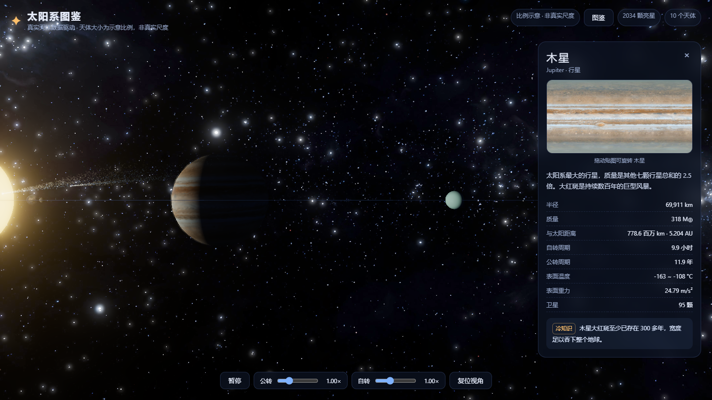

# Solar System Atlas (太阳系图鉴)

An interactive solar system driven by real data: the Sun, eight planets, the Moon, six large planetary moons and two comets, layered with the HYG bright-star catalog and a real Milky Way panorama.

[中文](README.md) | English

> **About sizes**: body sizes are **schematic, not to real scale** — radii are compressed with a 0.82 power: Earth = 1.85, Jupiter/Earth = 7.13 (real 10.97), Mars 0.60 (real 0.53); moons get an extra ×0.78, putting the Moon/Earth radius ratio at 0.269 ≈ the real 0.273. The Sun is capped at 17, otherwise it would swallow Mercury's orbit.
>
> **About moon orbits**: Callisto's real orbital radius is 27× Jupiter's radius — to scale it would reach Saturn's orbit, so moon orbits are compressed to 1.55–2.9× the parent's radius (ordering preserved). Moons also use their own 0.3 time multiplier (Io takes about 5.9 s per orbit); with the planetary 6.1 multiplier Io would loop in 0.29 s and strobe. The Earth–Moon pair keeps the planetary multiplier so a year still contains 13.37 lunations.
>
> **About time**: rotation and revolution are both derived from the real periods, but with different multipliers (spin 0.25, orbit 6.1), so scene time is compressed 24.4× overall. Relative rates between bodies match reality exactly; only the spin : orbit ratio is scaled down globally — otherwise Earth would spin once every 0.16 s and blur into a smear.
>
> **About stars**: the HYG catalog contributes direction only (parsec distances are discarded) and is projected onto a sphere of radius 2400, so the sky keeps the real celestial distribution but not real distances.
>
> **About star brightness**: the HYG catalog only lists stars brighter than about magnitude 6 (the naked-eye limit); each star's rendered brightness is a compressed function of its magnitude, so a mag-6 star is roughly 28% as bright as a mag-1 star — bright stars stand out, faint ones recede, instead of the whole sky glowing uniformly.

## Screenshots

| Overview | Planet detail |
| --- | --- |
|  |  |

Mobile (390×844):


## Features

- **Solar system**: the Sun, eight planets, the Moon, Io, Europa, Ganymede, Callisto, Titan and Triton, with parameters from NASA NSSDC (radius, mass, distance from the Sun/parent, rotation/orbital period, surface temperature, surface gravity, moon count). Every moon is tidally locked; Triton orbits retrograde.
- **Comets**: Halley 1P (inclination 162.3°, retrograde, 76-year period) and Encke 2P (inclination 11.8°, prograde, 3.30 years), with real perihelion/aphelion; the ion tail points strictly anti-sunward, while the dust tail inherits the comet's local orbital velocity — curved near perihelion, straighter near aphelion.
- **Real sky**: an 8k Milky Way panorama plus 2034 HYG bright stars placed by their true celestial directions.
- **Atlas**: 16 bodies plus 2034 bright stars, with moons indented under their parent planet; stars are sorted brightest-first, paginated 60 per page, and "Turn to this star" aims the view at the selected one.
- **Free camera**: drag to orbit, scroll to zoom, pause, reset view; the render loop stops automatically when the tab is hidden.
- **Speed control**: independent sliders for orbital and spin speed — down to 0 or up.
- **Click to focus**: click any body in the 3D view to fly to it; a detail panel opens on the right. Focusing a planet reveals its moon orbit guides, and focusing a moon switches to a close-up vantage.
- **Detail panel**: drag the texture sideways to spin the body, plus a parameter table and a fun fact.
- **Mobile friendly**: compact top bar, 2×2 control grid, full-screen atlas drawer and bottom-sheet detail panel on narrow screens.

## Tech stack

- Vite 8 + React 19 + TypeScript 7 (strict)
- Three.js 0.187: OrbitControls, EffectComposer / UnrealBloomPass, ShaderMaterial (Saturn's rings), CanvasTexture, Sprite, Points
- Two-stage textures: 2k base maps load with the scene, 4k maps are lazy-loaded when a body is focused; all textures are WebP, about 45% of the original JPG size
- Everything runs locally — no backend, no AI API

## Run locally

```bash
npm install
npm run dev        # http://localhost:5173
npm run build      # output to dist/
npm run preview
```

## Project layout

```
src/
  data/        planets.json / stars.json / bodies.ts / textures.ts
  three/       UniverseScene.ts   3D scene: bodies, orbits, camera, picking
  ui/          CatalogPanel.tsx   Atlas (solar system + stars, paginated)
               DetailPanel.tsx    Detail panel with draggable texture
```

## Data sources

- Planets and moons: NASA National Space Science Data Center (NSSDC)
- Comet orbits: JPL Small-Body Database (perihelion, aphelion, inclination and period of Halley 1P and Encke 2P)
- Stars: HYG bright-star catalog, 2034 entries (name, constellation, magnitude, celestial direction, RGB)
- Textures: planets, the Moon, the Milky Way and Saturn's rings come from [Solar System Scope](https://www.solarsystemscope.com/textures/) (CC BY 4.0) — 2k base maps plus lazy-loaded 4k, all converted to WebP. Io, Europa, Ganymede and Callisto use official global mosaic samples from [USGS Astrogeology](https://astrogeology.usgs.gov/) (1024 px, Voyager + Galileo SSI, polar gaps filled). Titan has only a near-infrared near-global map and Triton no equirectangular global map at all, so those two are generated procedurally from their real surface traits (orange haze; mottled nitrogen-ice frost). A procedural texture is the fallback if any load fails.
