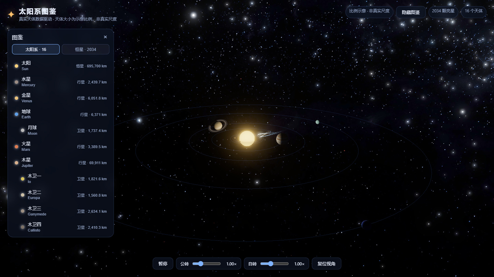
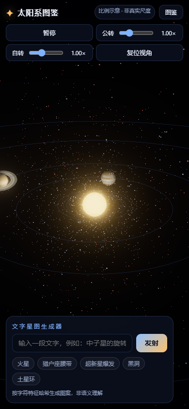

# Solar System Atlas (太阳系图鉴)

An interactive solar system driven by real data: the Sun, the eight planets and the Moon, layered with the HYG bright-star catalog, plus a "Text Star-map Generator".

[中文](README.md) | English

> **About scale**: body sizes in the scene are **schematic, not to real scale** — planets are compressed with a 0.55 power of their radius and HYG stars are scaled by parsec. Two coordinate systems are overlaid purely for looks; they do not represent real distances or size ratios.
>
> **About the "Text Star-map Generator"**: it is a **character-feature hash** (text is split into character n-grams, hashed into a vector, then FFT-smoothed into a 256-band energy profile) that drives the nebula's shape and palette. It is **not semantic understanding** — swap the word order or use a synonym and the pattern changes.

## Screenshots

| Overview | Planet detail |
| --- | --- |
|  |  |

Mobile (390×844):



## Features

- **Solar system**: Sun, eight planets and the Moon, with parameters from NASA NSSDC (radius, mass, distance from the Sun, rotation/orbital period, surface temperature, surface gravity, moon count).
- **Free camera**: drag to orbit, scroll to zoom, pause, reset view.
- **Speed control**: independent sliders for orbital and spin speed — down to 0 or up.
- **Click to focus**: click any body in the 3D view to fly to it; a detail panel opens on the right.
- **Detail panel**: drag the texture sideways to spin the body, plus a parameter table and a fun fact.
- **Atlas**: left-hand list with a "Solar System" and a "Stars · 2034" tab; stars can be searched by name or constellation, and "Turn to this star" aims the view at it.
- **Text Star-map Generator**: type some text (or pick a quick chip) and "launch" to render a text star-map locally, written into the URL for sharing; if the text names a body, it also focuses that body.
- **Mobile friendly**: compact top bar, 2×2 control grid, full-screen atlas drawer and bottom-sheet detail panel on narrow screens.

## Tech stack

- Vite 5 + React 18 + TypeScript (strict)
- Three.js: OrbitControls, EffectComposer / UnrealBloomPass, ShaderMaterial (Saturn's rings), CanvasTexture, Sprite, Points
- Everything runs locally — no backend, no AI API

## Run locally

```bash
npm install
npm run dev        # http://localhost:5173
npm run build      # output to dist/
npm run preview
```

## Project layout

```
src/
  data/        planets.json / stars.json / bodies.ts / textures.ts
  three/       UniverseScene.ts   3D scene: bodies, orbits, camera, picking
  ui/          CatalogPanel.tsx   Atlas (solar system + stars)
               DetailPanel.tsx    Detail panel with draggable texture
  launcher/    Launcher.tsx       Text star-map launcher
               seed.ts            URL seed read/write
  semantic/    engine.ts          character-feature hash → 256-band profile
               NebulaOverlay.tsx  text star-map overlay
```

## Data sources

- Planets and the Moon: NASA National Space Science Data Center (NSSDC)
- Stars: HYG bright-star catalog, 2034 entries (name, constellation, magnitude, parsec coordinates, RGB)
- Textures: `public/textures/`, with a procedural texture fallback on load failure
