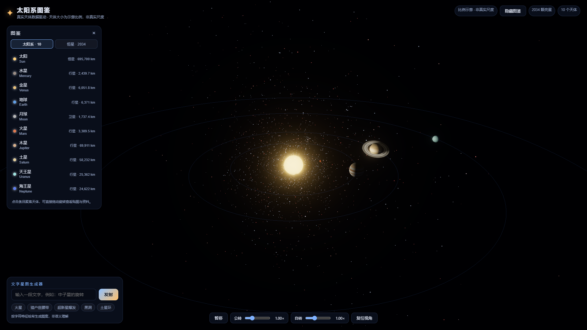
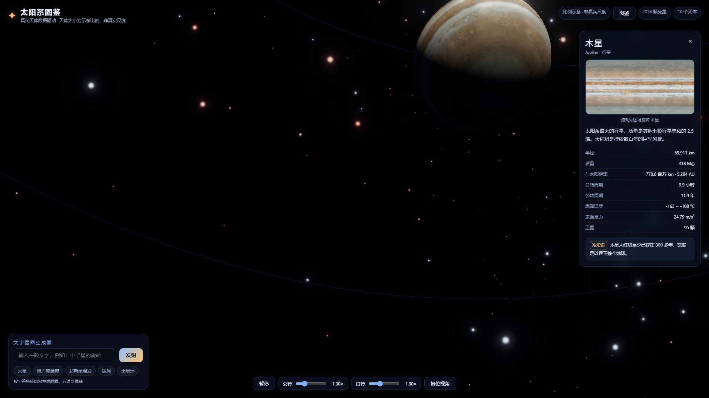
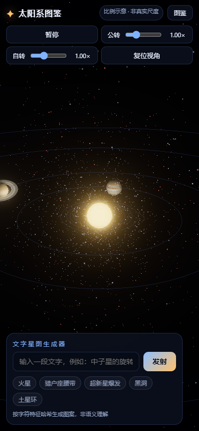

# 太阳系图鉴 Solar System Atlas

真实数据驱动的交互式太阳系：太阳、八大行星与月球，叠加 HYG 亮星星表，附一个「文字星图生成器」。

在线预览（私有部署，需登录访问）：https://37ko0748zzjmtgs1ls3.traesite.cn

> **关于比例**：场景里的天体大小是**示意比例，非真实尺度**——行星按半径的 0.55 次方压缩，HYG 恒星按秒差距缩放，两套坐标系叠在一起，只为好看，不代表真实距离与大小关系。
>
> **关于「文字星图生成器」**：它是**字符特征哈希**（把文字切成字符 n-gram 后哈希成向量，再做 FFT 平滑得到 256 段能量分布），用来驱动星云的形态与配色。**不是语义理解**，词序或近义词一换，图案就会变。

## 截图

| 全景 | 行星详情 |
| --- | --- |
|  |  |

移动端（390×844）：



## 功能

- **太阳系**：太阳、八大行星、月球，参数取自 NASA NSSDC（半径、质量、距日距离、自转/公转周期、表面温度、表面重力、卫星数）。
- **自由观察**：拖拽旋转、滚轮缩放，可暂停、复位视角。
- **速度控制**：公转与自转各一条滑动条，可整体降速到 0，也可加速。
- **点击定位**：在三维视图里点中任意天体即聚焦过去，右侧弹出详情面板。
- **详情面板**：天体贴图可横向拖动模拟自转，附参数表和一条冷知识。
- **图鉴**：左侧列表分「太阳系」与「恒星 · 2034」两个标签；恒星支持按名称/星座搜索，点「转向该恒星」把视线转过去。
- **文字星图生成器**：输入一段文字（或用快捷词条）「发射」，本地即时生成一张文字星图，并把文字写进 URL 便于分享；若文字正好点名了某个天体，会顺手聚焦到它。
- **移动端适配**：窄屏下顶栏压缩、控制条改为 2×2 网格、图鉴变整屏抽屉、详情变底部抽屉。

## 技术栈

- Vite 5 + React 18 + TypeScript（strict）
- Three.js：OrbitControls、EffectComposer / UnrealBloomPass、ShaderMaterial（土星环）、CanvasTexture、Sprite、Points
- 全部本地计算，无后端、无 AI 接口

## 本地运行

```bash
npm install
npm run dev        # http://localhost:5173
npm run build      # 产物输出到 dist/
npm run preview
```

## 目录结构

```
src/
  data/        planets.json / stars.json / bodies.ts / textures.ts
  three/       UniverseScene.ts   三维场景：天体、轨道、相机、拾取
  ui/          CatalogPanel.tsx   图鉴（太阳系 + 恒星）
               DetailPanel.tsx    详情面板（可拖动贴图）
  launcher/    Launcher.tsx       文字星图生成器发射台
               seed.ts            URL 种子读写
  semantic/    engine.ts          字符特征哈希 → 256 段能量分布
               NebulaOverlay.tsx  文字星图浮层
```

## 数据来源

- 行星与月球参数：NASA National Space Science Data Center（NSSDC）
- 恒星：HYG 亮星星表，2034 颗（含名称、星座、星等、秒差距坐标、RGB）
- 贴图：`public/textures/`，加载失败时用程序化纹理兜底
